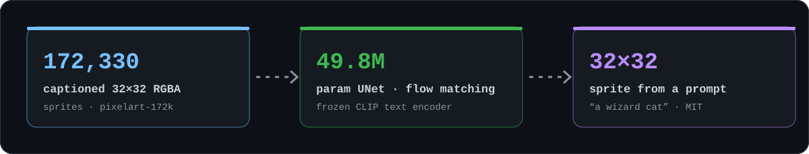
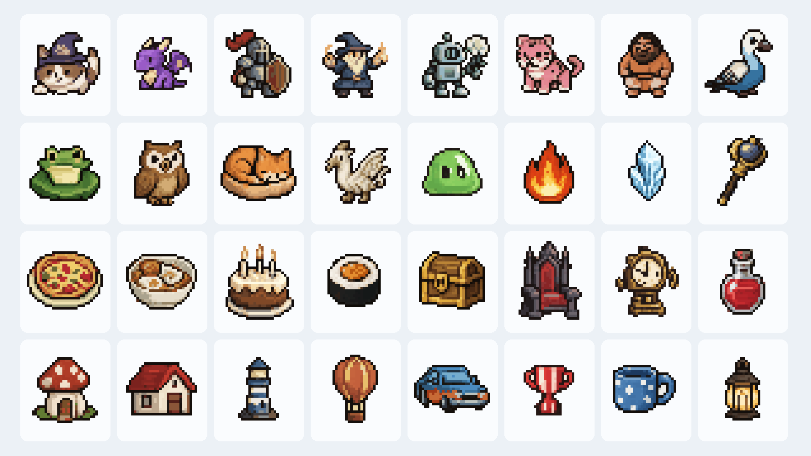

  

  
  
  

---

## 🎨 pixelart-50m: a text-to-sprite model trained from scratch

Built end to end, from dataset to training and sampling: a small diffusion model that turns a short prompt into a 32×32 game sprite. Model and dataset are open source (MIT).

  

  
   
  Samples from <b>pixelart-50m</b>, upscaled from 32×32.

<table>
  <tr>
    <td width="33%" valign="top">
      <b>🧠 <a href="https://huggingface.co/azygod/pixelart-50m">pixelart-50m</a></b> 
      49.8M UNet · flow matching · CLIP text encoder  
      
    </td>
    <td width="33%" valign="top">
      <b>🗂️ <a href="https://huggingface.co/datasets/azygod/pixelart-172k">pixelart-172k</a></b> 
      172,330 captioned RGBA sprites + 1,634 validation  
      
      
    </td>
    <td width="33%" valign="top">
      <b>🖌️ <a href="https://huggingface.co/azygod/Krea-2-pixelart-lora">Krea-2-pixelart-lora</a></b> 
      Pixel-art LoRA I trained to generate synthetic training data  
      
    </td>
  </tr>
</table>

> **🚧 Training now:** a bigger 64×64 RGBA pixel-art diffusion model with 100M+ parameters.

---

## 🛠️ Other things I build

| | Project | What it is |
|:-:|---|---|
| 📱 | **[pocket-agent](https://github.com/azygoss/pocket-agent)** | Self-hosted Android terminal and agent companion: SSH, persistent tmux, SFTP, and approving Claude / Codex actions from your phone. Kotlin + Go. |
| 🖥️ | **[pi-desktop](https://github.com/azygoss/pi-desktop)** | Open-source desktop app (Electron) for the pi coding agent, plus Pi Remote for iOS and Android. |
| 🤖 | **[hermes-android](https://github.com/azygoss/hermes-android)** | Android app for Hermes Agent: chat, sessions, skills, cron, memory and tools from your phone. |
| ⚔️ | **Last Cast** (private) | Isometric low-poly hack-and-slash in Unreal Engine 5. |
| 🦀 | **Game engine** (private) | A small game engine written in Rust. |

---

## 🧰 Tools I use

  
  
  
  
  
  
  
  
  
  

